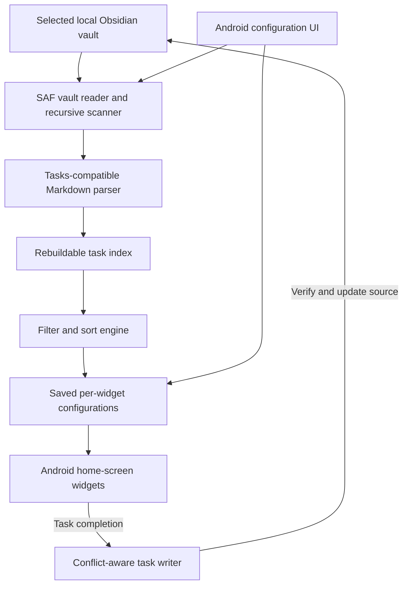

# Obsidian Tasks — Android Widget Design

**Status:** Proposed specification · **Version:** 0.1 · **Research checked:** 2 November 2026

## 1. Problem statement

Tasks in the existing Obsidian vault are embedded throughout ordinary Markdown notes and nested folders. They use the [Obsidian Tasks plugin](https://github.com/obsidian-tasks-group/obsidian-tasks) syntax, including emoji metadata for due dates, scheduled dates, priorities and recurrence. The desired Android home-screen experience is a live, interactive list of tasks selected **from the entire vault**, with independently configurable filters such as **due today**, **due soon**, **high priority**, or logical combinations of those conditions.

Available applications solve only parts of this problem. TaskForge supports richer task widgets but puts the useful widget functionality behind a paid tier; VaultMate provides a largely fixed Today widget; Todosian provides a free widget and Tasks metadata parsing but organises work around a selected task folder and file-based categories; and other Obsidian widgets display selected notes rather than a vault-wide task query. A recurring subscription is not justified for the intended fully local use case.

**Proposed solution:** Build a **free, open-source, offline-first Android app** that reads the existing vault, indexes tasks without copying them into a new source of truth, evaluates saved queries and renders them as configurable, interactive home-screen widgets. Use permissively licensed Android projects as a starting point rather than writing all components from scratch.

## 2. Goals, boundaries and success criteria

### Goals

1. Discover eligible task lines recursively in **all Markdown files across the selected vault**, including tasks embedded inside ordinary notes.
2. Parse the standard emoji-based Obsidian Tasks metadata and preserve all original Markdown on edits.
3. Support due-date, priority, scheduled-date and status filters, with **AND**, **OR** and saved filter configurations.
4. Display a scrolling task list in one or more independent Android widgets; complete a task directly from a widget and open its source note in Obsidian.
5. Require **no server, account, network connection, subscription or particular synchronisation service**.
6. Release the app under a permissive open-source licence, subject to attribution and third-party dependency review.

### Not in scope for the first release

Cloud synchronisation, accounts, a full Markdown editor, a replacement for Obsidian, calendar integration, push infrastructure, and an implementation of every Obsidian Tasks query-language feature. Full recurrence execution is a later milestone; displaying and preserving recurrence metadata is needed earlier.

### Definition of success

Given tasks in at least two unrelated nested notes, a user can add **two widgets with different filters** (for example, `due on or before today` and `due within seven days OR priority at least high`). Both scan the full vault. Checking a task in either widget updates **only the correct source task** without damaging neighbouring Markdown; the other widget refreshes to reflect the change.

## 3. Functional requirements

**Priority:** P0 = minimum viable product (MVP); P1 = next release; P2 = later enhancement. A requirement can be implemented progressively while maintaining compatibility with source notes.

### 3.1 Vault access and discovery

| ID | Priority | Requirement |
|---|---|---|
| V-01 | P0 | Select a locally accessible Obsidian vault through Android's Storage Access Framework (SAF) and persist the granted directory permission. |
| V-02 | P0 | Traverse the selected vault recursively; find `*.md` in nested directories, without requiring a dedicated task folder. |
| V-03 | P0 | Discover checkbox tasks embedded in normal notes; retain source document URI/path, heading/context where possible, and line reference. |
| V-04 | P0 | Use Markdown files as the single source of truth; any database or in-memory index is a rebuildable cache. |
| V-05 | P0 | Preserve unrelated lines, indentation, task text, tags and unknown metadata during a task-status update. |
| V-06 | P1 | Configure excluded folders (for example `.obsidian`, archive folders or templates), while retaining full-vault scanning as the default scope. |
| V-07 | P1 | Refresh when files are changed externally, when a widget is used and on manual request; handle app restart and midnight date transitions. |
| V-08 | P1 | Index incrementally where feasible, with a full-rescan fallback for providers that do not expose reliable change signals. |

### 3.2 Obsidian Tasks format

| ID | Priority | Requirement |
|---|---|---|
| T-01 | P0 | Recognise standard unchecked and completed Markdown tasks (`- [ ]`, `- [x]`), including nested tasks. |
| T-02 | P0 | Parse `📅 YYYY-MM-DD` due dates and `⏳ YYYY-MM-DD` scheduled dates. |
| T-03 | P0 | Parse the priority markers `🔺`, `⏫`, `🔼`, `🔽`, `⏬`, as well as tasks without a priority marker. |
| T-04 | P0 | Handle several metadata tokens on one line and preserve unrecognised suffix content. |
| T-05 | P0 | Update task checkbox state in the original note and preserve or correctly update any completion metadata according to the supported Tasks format. |
| T-06 | P1 | Parse `🛫` start dates, `➕` created dates, `✅` done dates and `❌` cancelled dates, plus associated task statuses. |
| T-07 | P1 | Parse task tags and link the displayed task to its source note; support plain text and common inline Markdown without altering them. |
| T-08 | P1 | Recognise and display `🔁 ...` recurrence rules, without changing their meaning. |
| T-09 | P2 | Complete recurring tasks using recurrence semantics compatible with the Obsidian Tasks plugin, including creation of the next occurrence where required. |
| T-10 | P2 | Extend syntax coverage using conformance fixtures from the official plugin (ordered-list checkboxes, alternate states, nested tasks, supported date and recurrence expressions). |

**Scope note:** Reading `🔁 every week` and showing a recurrence indicator is **not equivalent** to implementing recurrence. Until T-09 is implemented and tested, the app must not silently treat a recurring task as an ordinary task if that would lose the next occurrence. It may open the task in Obsidian or disable direct completion for unsupported recurrence rules.

### 3.3 Query and filtering engine

| ID | Priority | Requirement |
|---|---|---|
| Q-01 | P0 | Query tasks across the **entire indexed vault**, not just a chosen note, folder or file category. |
| Q-02 | P0 | Filter by completion state: open, completed and (later) other supported statuses. |
| Q-03 | P0 | Filter by due date: overdue, due today, due on/before today, and due within the next configurable **N** days. |
| Q-04 | P0 | Filter by priority: exact priority and thresholds such as high-or-higher. |
| Q-05 | P0 | Combine due-date and priority predicates using **AND** or **OR**. |
| Q-06 | P0 | Save, rename and reuse named filters; allow a different filter per widget. |
| Q-07 | P0 | Sort results by due date or priority, with a deterministic tie-breaker. |
| Q-08 | P1 | Filter by scheduled date, start date, tags, source folder and task status. |
| Q-09 | P1 | Support grouped/nested boolean expressions, negation and filters for tasks without dates. |
| Q-10 | P1 | Show a live preview and matching-task count in the filter editor. |

**Date semantics:** Use the device's local calendar date, not UTC timestamps, for `YYYY-MM-DD` task markers. Define `due today` as an exact-date condition; provide `due today or overdue` as a separate condition. A suggested default for **due soon** is due from today through today + 7 calendar days, inclusive, with an explicit option to include overdue tasks. These choices must be visible in the configuration interface.

### 3.4 Home-screen widgets and settings

| ID | Priority | Requirement |
|---|---|---|
| W-01 | P0 | Show a scrollable list of tasks matching a saved filter. |
| W-02 | P0 | Support multiple widget instances with independent filter selections. |
| W-03 | P0 | Allow a user to check off a supported non-recurring task directly in the widget. |
| W-04 | P0 | Display task text and relevant due-date/priority metadata compactly. |
| W-05 | P0 | Provide a manual refresh action and useful empty/error states (no matches, no vault access, scan failure). |
| W-06 | P1 | Open the source note in Obsidian; jump to the task where a reliable deep-link mechanism exists. |
| W-07 | P1 | Allow widget-specific appearance choices, including sizing, visible metadata, text density and theme. |
| W-08 | P1 | Show overdue/high-priority distinctions and optionally include source note or folder labels. |
| W-09 | P1 | Provide a graphical filter editor, named presets and a widget configuration screen that does not require writing query syntax. |
| W-10 | P2 | Provide richer widgets (grouping, custom headers, colour preferences and quick task entry). |

## 4. Non-functional requirements

| ID | Requirement |
|---|---|
| N-01 | Entirely local operation; no account, telemetry, analytics, server or required network permission. |
| N-02 | Free distribution with a permissive project licence; retain all upstream licences, notices and required attribution. |
| N-03 | Least-privilege storage access through SAF; no broad all-files access if SAF supports the target vault. |
| N-04 | Safe, conflict-aware writes. Before changing a task, re-read its source and verify the expected line/content; refuse or retry safely when it has changed. |
| N-05 | Never silently overwrite unrelated edits or corrupt Markdown if sync or Obsidian modifies a note concurrently. |
| N-06 | Handle thousands of Markdown files without long main-thread blocking; use background indexing and bounded refresh frequency. |
| N-07 | Limit battery usage; avoid continuous file polling and unnecessary full scans. |
| N-08 | Keep parsing, filtering and vault access independent of the Android widget layer to permit unit testing. |
| N-09 | Preserve non-task formatting, line endings where practical, indentation and unknown plugin metadata. |
| N-10 | Provide error reporting for denied permissions, unavailable documents, malformed metadata and conflicting writes. |
| N-11 | Support current Android versions; choose a minimum Android API level after evaluating the upstream widget base. |
| N-12 | Use stable task identity for UI interactions; never rely solely on a cached line number or widget list position. |

## 5. Proposed technical architecture

**Preferred implementation:** Kotlin Android application. Use the **native Android App Widget system** already present in a candidate repository; use SAF for permission-scoped vault access. Jetpack Compose is appropriate for the configuration app, but the choice between native `RemoteViews`/collection widgets and Jetpack Glance should be made after a working widget prototype. Use Room or an equivalent lightweight local index only if needed for scan performance.



**Component boundaries**

- **Vault reader:** obtains and retains SAF grants; traverses document-tree URIs; excludes selected folders; reads UTF-8 Markdown safely.
- **Parser:** turns a task line into a typed record containing status, task text, dates, priority, tags, recurrence text and source reference. It must be separately testable.
- **Index:** associates each parsed task with its original source and a content fingerprint. It is a cache, not a second task database.
- **Query engine:** evaluates predicates and boolean combinations; uses deterministic ordering and local-calendar date handling.
- **Widget provider:** renders filtered records, routes checkbox actions and triggers refresh; each widget references a saved filter identifier.
- **Writer:** re-reads the source document before modification, confirms the task is still identifiable and unchanged, then performs the smallest safe edit supported by the document provider. On conflict, it does not overwrite the file and prompts a rescan.

**Important constraint:** Android document providers differ in their write and rename behaviour. Do not assume a POSIX-style atomic replacement is available through SAF. Test the write path with the actual vault storage/synchronisation mechanism, including simultaneous Obsidian edits.

## 6. Recommended open-source repositories and component reuse

The following features and licences were checked against published repository documentation on **2 November 2026**. They are **candidate reuse sources, not audited dependencies**. Inspect the actual tagged revision and dependency tree before copying code.

| Repository | Stack / licence | Reuse target | Existing limitation / work needed | Role |
|---|---|---|---|---|
| [Todosian](https://github.com/isotjs/todosian-app) | Kotlin, Jetpack Compose; **Apache-2.0** | Obsidian Tasks emoji parser, Markdown task edit operations, interactive task-list widget, local SAF folder access | Its model treats files as categories; must introduce recursive all-vault discovery, cross-file index and custom query widgets | **Primary candidate if retaining a task-app UI** |
| [Obsidian Widget for Android](https://github.com/harshilchordia/obsidian-widget) | Kotlin, AndroidX; **MIT** | `AppWidgetProvider`, scrolling `RemoteViewsService` list, per-widget settings, SAF vault picker, source-file checkbox actions | Operates primarily on daily or selected notes; requires full-vault scanner, Tasks parser and query engine | **Primary candidate for a lean widget-first app** |
| [Obsidian Agenda](https://github.com/hoheinzollern/obsidian-agenda) | Flutter/Dart; **MIT** | Recursive vault scanner, task model/parser, date buckets, source-note navigation, conflict-aware writer design | Flutter code is not directly importable into a Kotlin app; no Android home-screen task widget; Android permissions need review | **Reference implementation / potential port** |
| [Obsidian Note Widget](https://github.com/kleokl7/Obsidian-Note-Widget) | Kotlin; **MIT** | Alternative interactive widget, checkbox handling, note deep links, widget tests/continuous integration | Selected-note approach; task query and emoji-date parser absent or unverified | **Alternative widget base** |
| [Obsidian Todo Widget](https://github.com/YukiGasai/obsidian-todo-widget) | Android; **Apache-2.0** | Minimal single-file Markdown task widget | Limited to selected files/date patterns, not vault-wide aggregation; evaluate maintenance before adopting | **Minimal reference** |
| [Agendula](https://codeberg.org/jlmakiola/agendula) ([F-Droid](https://f-droid.org/packages/de.jeanlucmakiola.agendula/)) | Android; **MIT** (per F-Droid) | Saved-filter user experience, due-date/priority/tag filtering, configurable task widgets | Uses its own task storage, not Obsidian Markdown; source not fully audited in this review | **UI/query-design reference** |
| [Official Obsidian Tasks](https://github.com/obsidian-tasks-group/obsidian-tasks) | TypeScript; **MIT** | Canonical syntax, date and priority semantics, recurrence specification and test fixtures | Depends on Obsidian; not a native Android widget library | **Compatibility oracle and test source** |

### Suggested module-level sources

- **Native widget UI:** [Obsidian Widget / `ObsidianWidgetProvider.kt`](https://github.com/harshilchordia/obsidian-widget/blob/main/app/src/main/java/com/obsidianwidget/ObsidianWidgetProvider.kt), [`ChecklistWidgetService.kt`](https://github.com/harshilchordia/obsidian-widget/blob/main/app/src/main/java/com/obsidianwidget/ChecklistWidgetService.kt) and [`WidgetConfigActivity.kt`](https://github.com/harshilchordia/obsidian-widget/blob/main/app/src/main/java/com/obsidianwidget/WidgetConfigActivity.kt).
- **SAF and note-level Markdown write path:** [Obsidian Widget / `VaultManager.kt`](https://github.com/harshilchordia/obsidian-widget/blob/main/app/src/main/java/com/obsidianwidget/VaultManager.kt). Audit write-conflict behaviour before reuse.
- **Recursive scanner and source tracking:** [Obsidian Agenda / `vault_service.dart`](https://github.com/hoheinzollern/obsidian-agenda/blob/main/lib/services/vault_service.dart), [`task.dart`](https://github.com/hoheinzollern/obsidian-agenda/blob/main/lib/models/task.dart) and [`task_writer.dart`](https://github.com/hoheinzollern/obsidian-agenda/blob/main/lib/services/task_writer.dart).
- **Emoji parser and completion format:** Todosian's task model/Markdown code (locate exact Kotlin files in the chosen tagged version); compare output with official Obsidian Tasks test cases.
- **Saved query UX:** Agendula's saved-filter widgets, documented in its [F-Droid 1.1.0 changelog](https://f-droid.org/packages/de.jeanlucmakiola.agendula/).

### Initial fork decision

**Default recommendation: fork [Obsidian Widget for Android](https://github.com/harshilchordia/obsidian-widget)** if the primary product is a compact, highly configurable home-screen widget. It already has a mature-enough native widget skeleton, per-instance settings and SAF access. Reuse or adapt the Tasks metadata logic from **Todosian**, and use **Obsidian Agenda** and **Official Obsidian Tasks** for scanner/writer and parsing semantics.

**Alternative: fork [Todosian](https://github.com/isotjs/todosian-app)** if the product should also be a full task-management application. This avoids rewriting the metadata parser and some task operations, but may require more refactoring of its category-centric data model. Decide only after a short source-level proof of concept, not on README claims alone.

Avoid using GPL-licensed code as the application base if the project is intended to remain permissively licensed. For MIT and Apache-2.0 code, preserve copyright notices and Apache NOTICE/attribution obligations, and review dependencies and code provenance. This is a software-design note, not a legal opinion.

## 7. Validation fixture and acceptance tests

### Example source files

`Projects/Research.md`:

```markdown
# Research
- [ ] Review preprint #research 🔺 📅 2026-11-02
- [ ] Draft notes #research ⏳ 2026-11-03 📅 2026-11-07
```

`Personal/Household/Tasks.md`:

```markdown
# Household
- [ ] Order supplies ⏫ 📅 2026-11-06
- [ ] Clean kitchen 🔽
- [ ] Weekly review 🔁 every week 📅 2026-11-02
```

**Assume the local date is 2 November 2026.**

| Test | Filter / action | Expected result |
|---|---|---|
| AT-01 | Full-vault scan | Finds all five tasks in both nested files, with accurate source references. |
| AT-02 | `due today` | Finds Review preprint and Weekly review. |
| AT-03 | `due in next 7 days AND priority >= high` | Finds Review preprint and Order supplies; exclude recurrence only from **completion**, not from filtering. |
| AT-04 | `due today OR priority >= high` | Finds Review preprint, Weekly review and Order supplies; no duplicates. |
| AT-05 | Widget A uses `due today`; Widget B uses `priority >= high` | Widgets show distinct results from the same vault. |
| AT-06 | Complete Review preprint from Widget A | Only its original task line in `Projects/Research.md` changes; both widget lists refresh. |
| AT-07 | Source file changes between scan and completion | Detect conflict and do not overwrite the intervening edit. |
| AT-08 | Complete a recurring task before recurrence support is ready | Do not silently lose recurrence; use a safe fallback. |
| AT-09 | Deny or revoke vault permission | Widget shows an actionable error rather than an empty success state. |
| AT-10 | Add a task to another nested file and refresh | New task appears without changing any widget's configured scope. |

Additional parser tests should include different token orders, missing dates, Markdown code fences, nested and ordered-list tasks, non-ASCII text, duplicate task descriptions, unfamiliar custom checkbox states, malformed metadata, CRLF line endings and tasks moved between files. Compare against the official Tasks plugin where its semantics are defined.

## 8. Implementation plan

### Phase 0 — Select and prove the base

- Build **Obsidian Widget** and **Todosian** locally from source; inspect their actual parsing, storage, licence and widget APIs.
- Prototype scanning two nested files using SAF and mapping each result back to its source.
- Prove that a widget action can update one task safely after an external file edit; test on the target phone/vault storage.
- Choose the fork based on code quality and complexity, not only the number of advertised features.

### Phase 1 — Minimum viable product

Deliver V-01–V-05; T-01–T-05; Q-01–Q-07; W-01–W-05; and core N requirements. Include at least two independently configured widgets, due-date/priority AND/OR filtering, and safe completion for non-recurring tasks.

### Phase 2 — Practical daily use

Add scheduled/start-date filters, tags, preview/editor, source-note links, incremental refresh, metadata-rich display and configurable exclusion folders. Strengthen compatibility tests and support a larger range of Android file providers.

### Phase 3 — Advanced Tasks compatibility

Add recurrence generation, alternative task statuses, richer query expressions and expanded widget customisation. Use official Tasks plugin fixtures to detect behaviour differences.

## 9. Development environment

**Environment set up:** 2 November 2026, on macOS (Apple silicon).

### Toolchain

| Component | Version |
|---|---|
| Android Studio | Rabbit 2, 2026.2.2 (build AI-262.10968.63) |
| SDK Platform | Android 17, `platforms;android-37.0` (API 37), with sources |
| Build-tools | 37.0.0 |
| Platform-tools (adb) | 37.0.1 |
| Emulator | 37.2.13 |
| SDK command-line tools | latest (`sdkmanager` and `avdmanager`; the new `android` CLI is bundled) |
| JDK | Android Studio's bundled JBR 21 for Gradle; Temurin 17 on the shell `PATH` |
| Gradle / Android Gradle Plugin / Kotlin | Set per project by the Gradle wrapper. Latest stable at setup: Gradle 9.8.2, AGP 9.5.0, Kotlin 2.4.21 |

`~/.zshrc` sets `ANDROID_HOME=~/Library/Android/sdk` and adds `platform-tools`, `cmdline-tools/latest/bin` and `emulator` to the `PATH`. Build with `compileSdk`/`targetSdk` 37 to match the target device.

### Test devices

| Device | Role | Details |
|---|---|---|
| Emulator `Pixel_10_Pro_XL_API_37` | **Main development target** | Android 17 (API 37), Google Play image (`system-images;android-37.0;google_apis_playstore;arm64-v8a`). The screen size is close to the S26+. The test vault from §7 is copied into the emulator's shared `Documents/` with `adb push`, so development doesn't need Obsidian or Obsidian Sync on the emulator. |
| Samsung Galaxy S26+ | **Real-world testing** | One UI 9 (Android 17, API 37). Needs Developer options and USB or wireless debugging turned on. Samsung Auto Blocker may block sideloaded installs. Used for the real vault, Samsung launcher widget behaviour, and concurrent-edit and sync-conflict testing (AT-06, AT-07, N-04, N-05). |

### Vault on the physical phone

- The vault is synced with **Obsidian Sync**. Obsidian Sync has no Android document provider, so the app reads the vault folder Obsidian syncs into. It does not talk to Sync itself.
- **To check in Phase 0:** whether that folder is in shared storage (normally under `Documents/`), where SAF can reach it, or in Obsidian's app-private storage, where it can't (see the storage-provider risk in §10). Obsidian's vault switcher shows the vault's location.
- Obsidian Sync can change a note while the widget is writing to it. The conflict-aware writer has to be tested on the phone while sync is active, not just on the emulator.

## 10. Risks and open decisions

| Topic | Risk / decision |
|---|---|
| Repository choice | Todosian already parses emoji tasks; Obsidian Widget has more direct per-widget infrastructure. Compare source-level coupling before selecting. |
| Storage provider | Some vaults may be stored in Android app-private areas or unavailable to SAF; test real vault accessibility first. |
| File modification | Synchronisation conflicts and stale line positions are the greatest data-integrity risk. Fail closed on ambiguous matches. |
| Recurrence | Incomplete recurrence semantics can silently drop future tasks. Defer completion or delegate it to Obsidian until compatible. |
| Refresh | Android widgets are not guaranteed instant external-change notifications; define a sensible scheduled/manual refresh policy. |
| Query semantics | Decide whether “due soon” includes overdue items, and show that choice explicitly. |
| Licensing | Verify each copied file, repository revision, third-party dependency and any `NOTICE` file before distribution. |
| Distribution | Decide between sideload/F-Droid/Google Play; storage permissions and signing rules affect packaging. |

## 11. Source links and verification notes

- [Todosian GitHub](https://github.com/isotjs/todosian-app) — README describes file-as-category model, Tasks emoji markers, widget and Apache-2.0 licence.
- [Obsidian Widget GitHub](https://github.com/harshilchordia/obsidian-widget) — README lists its native widget components, SAF use, per-widget settings and MIT licence.
- [Obsidian Agenda GitHub](https://github.com/hoheinzollern/obsidian-agenda) — README describes recursive scanning, parser/writer components and MIT licence; uses Flutter/Dart.
- [Obsidian Note Widget GitHub](https://github.com/kleokl7/Obsidian-Note-Widget) — selected-note widget, interactive checkboxes, MIT licence.
- [Obsidian Todo Widget GitHub](https://github.com/YukiGasai/obsidian-todo-widget) — selected-file widget; licence file is Apache-2.0.
- [Agendula F-Droid listing](https://f-droid.org/packages/de.jeanlucmakiola.agendula/) — MIT licence; saved-filter widgets detailed in the 1.1.0 changelog.
- [Official Obsidian Tasks GitHub](https://github.com/obsidian-tasks-group/obsidian-tasks) and [documentation](https://publish.obsidian.md/tasks/) — source of intended Tasks syntax and behaviour.
- [Android SAF documentation](https://developer.android.com/training/data-storage/shared/documents-files) — directory-tree permissions and platform restrictions.

**Research limitation:** These recommendations are based on repository descriptions and selected source-code inspection. No candidate was built, installed or subjected to integration tests during this design review. Re-evaluate exact code revisions before importing components.
