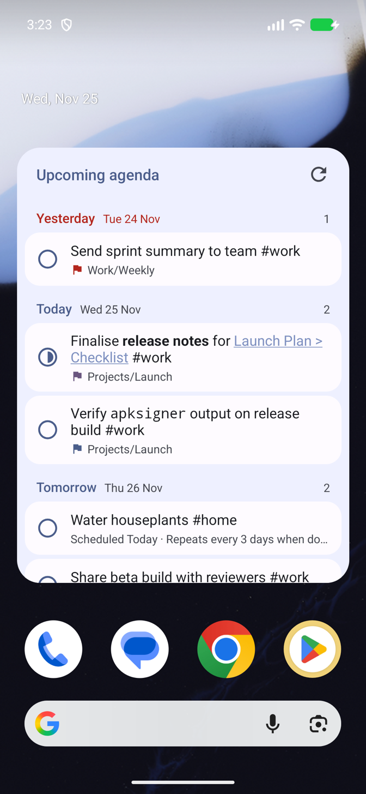
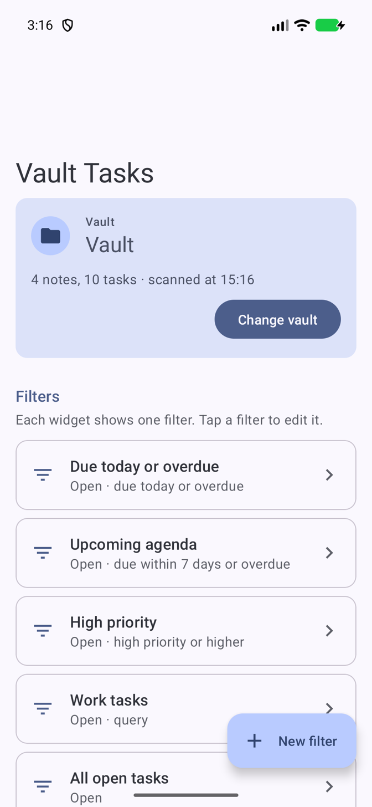
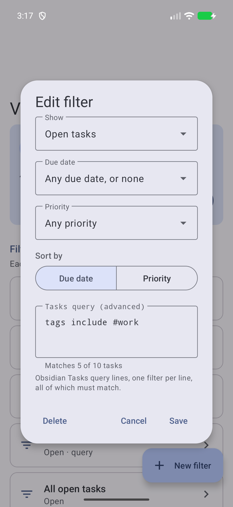
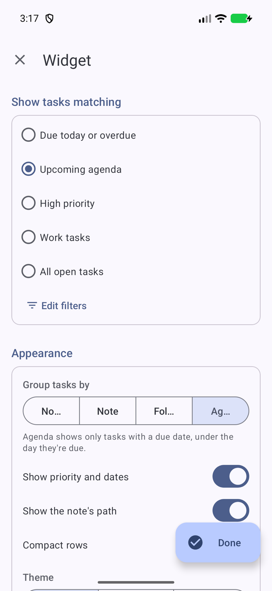

# Vault Tasks

Android home-screen widgets for [Obsidian Tasks](https://github.com/obsidian-tasks-group/obsidian-tasks) across your entire vault.

Vault Tasks scans your local Obsidian vault folder via Android's Storage Access Framework, displays live filtered task lists on your home screen with Material You styling, and lets you check tasks off directly in their source Markdown notes—completely offline, with no internet permission.

## Install

Requires **Android 12 (API 31)** or newer.

### Option 1: Obtainium (recommended for automatic updates)

[](https://apps.obtainium.imranr.dev/redirect?r=obtainium://add/https://github.com/OliverDudgeon/vault-tasks)

1. Install [Obtainium](https://obtainium.imranr.dev/) if you don't already have it.
2. Tap the **Get it on Obtainium** badge above to open the app entry directly in Obtainium, or manually add the repository URL:
   ```text
   https://github.com/OliverDudgeon/vault-tasks
   ```
3. Tap **Add** and install the latest release. Obtainium automatically tracks new GitHub Releases and installs updates in place—no extra APK filter rules are needed.

### Option 2: Direct APK download

1. Go to the [latest GitHub Release](https://github.com/OliverDudgeon/vault-tasks/releases/latest).
2. Download `vault-tasks-vX.Y.Z.apk` (and optionally verify its integrity against the accompanying `.sha256` file).
3. Open the downloaded APK on your Android device and allow installation from your browser or file manager if prompted.

### First-time setup

1. Open **Vault Tasks** and tap **Choose vault** to select your local Obsidian vault folder.
2. Review or customise your saved filters (or add new ones using guided controls or Obsidian Tasks queries).
3. Long-press your home screen to add a **Vault Tasks** widget, then pick a filter, grouping mode, and appearance for that widget.

## Screenshots

| Home-screen agenda widget | Vault & saved filters | Filter editor with Tasks query | Widget configuration |
| :---: | :---: | :---: | :---: |
|  |  |  |  |

## Features

- **Whole-vault scanning:** Recursively indexes Markdown notes across your vault (skipping `.obsidian/`) with an incremental cache based on file modification timestamps.
- **Safe in-place task completion:** Completing a task from a widget backs up the note first, verifies the note hasn't changed underneath you, and edits only the target task line (adding `✅ YYYY-MM-DD`). Conflicting edits and unsupported rules fail safely without touching your note.
- **Obsidian Tasks compatibility:** Supports emoji metadata (`📅`, `⏳`, `🛫`, `➕`, `✅`, `❌`, priority flags `🔺`–`⏬`, tags, `🆔`, `⛔`, `🏁 delete`), recurring task completion (`🔁`), statuses (`[ ]`, `[/]`, `[x]`, `[-]`), and inline Markdown rendering (bold, italic, strikethrough, highlight, code, links, and wikilinks).
- **Multiple independent widgets:** Place as many widgets as you want, each with its own saved filter, grouping (**None**, **Note**, **Folder**, or **Agenda** by due day), compact layout, and theme (**System** Material You, **Light**, or **Dark**).
- **Guided & query filters:** Combine status, due date ranges, and priority ranges with `AND`/`OR`, or write [Obsidian Tasks query](https://publish.obsidian.md/tasks/Queries/About+Queries) lines with a live match count.
- **Automatic midnight refresh:** Schedules a non-waking local midnight refresh so relative dates ("Today", overdue highlights) roll over cleanly.
- **Private & offline:** Requests no network permissions and stores all state locally on your device.

## Releasing (maintainers)

Releases are built, signed, tagged, and published to GitHub Releases via the manual [Release workflow](.github/workflows/release.yml) (`workflow_dispatch`). Every release attaches a single universal signed APK (`vault-tasks-vX.Y.Z.apk`) and its SHA-256 checksum (`vault-tasks-vX.Y.Z.apk.sha256`), which Obtainium picks up automatically.

### One-time signing setup

Android requires every update to be signed with the same release key. Generate a keystore once, back it up securely outside this repository, and store it in GitHub Actions secrets:

1. Generate a release keystore (keep this file private—never commit it):
   ```bash
   keytool -genkeypair -v \
     -keystore vault-tasks-release.jks \
     -alias vault-tasks \
     -keyalg RSA -keysize 4096 \
     -validity 10000
   ```
2. Base64-encode the keystore:
   ```bash
   base64 -i vault-tasks-release.jks | tr -d '\n'
   ```
3. In **Settings → Secrets and variables → Actions** on GitHub, add these four repository secrets:
   - `KEYSTORE_BASE64`: the base64-encoded keystore string
   - `KEYSTORE_PASSWORD`: the keystore password
   - `KEY_ALIAS`: the key alias (e.g. `vault-tasks`)
   - `KEY_PASSWORD`: the key password

### Creating a release

1. Open **Actions → Release → Run workflow** on GitHub (on `main`).
2. Enter the semantic version to release, e.g. `0.1.0` or `1.0.0` (or `1.0.0-beta.1` for a pre-release).
3. Optionally specify a `version_code` override or extra `release_notes` (by default `versionCode` is derived monotonically from the semantic version and changelog notes are auto-generated).
4. Click **Run workflow**. The workflow runs unit tests, builds and verifies the signed release APK, creates and pushes the annotated `vX.Y.Z` tag, and publishes the GitHub Release.

## Building from source

Requires **JDK 17** and the **Android SDK** (API 37).

```bash
# Run unit tests
./gradlew testDebugUnitTest

# Build a debug APK
./gradlew assembleDebug

# Build a signed release APK locally
SIGNING_KEYSTORE_PATH=/path/to/vault-tasks-release.jks \
SIGNING_KEYSTORE_PASSWORD=... \
SIGNING_KEY_ALIAS=vault-tasks \
SIGNING_KEY_PASSWORD=... \
./gradlew assembleRelease -PversionName=0.1.0 -PversionCode=10099
```

## License

Licensed under the [GNU General Public License v3.0 or later](LICENSE) (`GPL-3.0-or-later`).
